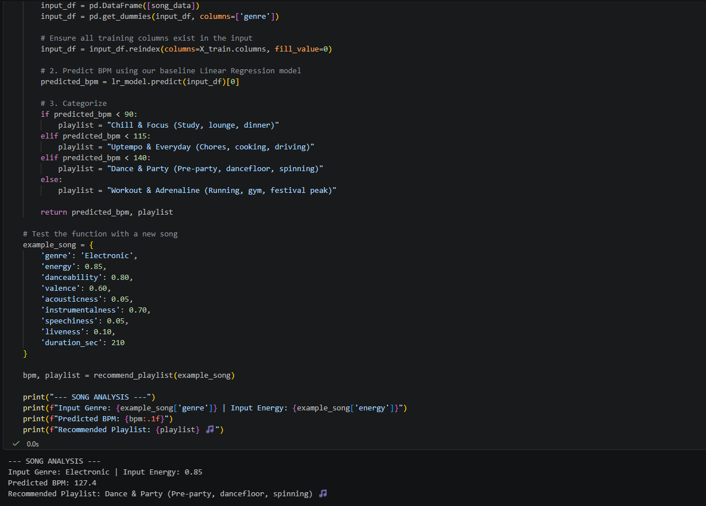

# 🎵 Spotify BPM Predictor & Playlist Recommender

## 📌 Executive Summary
Detta projekt demonstrerar en komplett Machine Learning-pipeline, från rå data till en användbar produkt. Genom att använda **Linjär Regression** förutsäger modellen en låts tempo (Beats Per Minute, BPM) baserat på dess ljudegenskaper och genre. Resultatet är en funktion som automatiskt kategoriserar låtar i spellistor (t.ex. "Träning", "Fest" eller "Chill") – en direkt användbar funktion för musikströmningstjänster.

## 🧠 Viktiga Insikter & Beslut (The Data Science Journey)
Projektet visar på vikten av att ifrågasätta data och fatta datadrivna beslut:
1. **Problemet med "Streams":** Initial EDA visade att förutsäga antal streams (ett populärt dataset på Kaggle) är extremt svårt. Ljudegenskaper som `energy` och `danceability` hade en korrelation på endast ~0.12 med streams. Slutsats: Popularitet drivs av marknadsföring och spellistor, inte bara ljudet.
2. **Pivoteringen:** Vi bytte målvariabel till `tempo_bpm` (BPM), där ljudegenskaperna har en logisk och statistiskt starkare koppling (R² = 0.36).
3. **Modellval:** Vi testade avancerade modeller (Ridge med interaktionstermer och Random Forest) för att se om icke-linjära samband fanns. Resultaten visade att en enkel Linjär Regressionsmodell var lika bra (och mer tolkningsbar). Detta bekräftar att sambandet mellan ljud och tempo är fundamentalt linjärt.

## 📊 Datainspektion & Feature Engineering
*   **Dataset:** 10 000 låtar med 17 attribut.
*   **Data Cleaning:** Variabeln `streams` hade en extrem snedhet (skewness = 18.39) och krävde en log-transformering för att bli användbar.
*   **Features:** Genomförde One-Hot Encoding på `genre` och valde ut 9 numeriska ljudegenskaper (bl.a. `energy`, `acousticness`, `danceability`).

## 📈 Modellprestanda
*   **Baseline (Linjär Regression):** R² = 0.365 | RMSE = 15.17 BPM
*   **Random Forest:** R² = 0.360 | RMSE = 15.23 BPM
*(Se `images/model_comparison.png` för bevis på att Linjär Regression valdes av en anledning).*

## 🚀 Produkten (Playlist Recommender)
Modellen är implementerad i en Python-funktion som tar en låts egenskaper och returnerar en spellistekategori. Felmarginalen på ~15 BPM är fullt acceptabel för att skilja på en långsam ballad (<90 BPM) och en snabb danslåt (>128 BPM).

**Exempel på output:**
> *"Modellen förutspår att låten har 126.4 BPM. Rekommendation: Låten passar perfekt för spellistan Dans & Fest 🎵"*

## 🛠️ Hur man kör projektet
1. Klona repot: `git clone [din-länk]`
2. Installera beroenden: `pip install -r requirements.txt`
3. Öppna notebooken i `notebooks/` och kör cellerna.

---
*Skapad av Jose A*# 🎵 Spotify BPM Predictor & Playlist Recommender

## 📌 Executive Summary
Detta projekt demonstrerar en komplett Machine Learning-pipeline, från rå data till en användbar produkt. Genom att använda **Linjär Regression** förutsäger modellen en låts tempo (Beats Per Minute, BPM) baserat på dess ljudegenskaper och genre. Resultatet är en funktion som automatiskt kategoriserar låtar i spellistor (t.ex. "Träning", "Fest" eller "Chill") – en direkt användbar funktion för musikströmningstjänster.

## 🧠 Viktiga Insikter & Beslut (The Data Science Journey)
Projektet visar på vikten av att ifrågasätta data och fatta datadrivna beslut:
1. **Problemet med "Streams":** Initial EDA visade att förutsäga antal streams (ett populärt dataset på Kaggle) är extremt svårt. Ljudegenskaper som `energy` och `danceability` hade en korrelation på endast ~0.12 med streams. Slutsats: Popularitet drivs av marknadsföring och spellistor, inte bara ljudet.
2. **Pivoteringen:** Vi bytte målvariabel till `tempo_bpm` (BPM), där ljudegenskaperna har en logisk och statistiskt starkare koppling (R² = 0.36).
3. **Modellval:** Vi testade avancerade modeller (Ridge med interaktionstermer och Random Forest) för att se om icke-linjära samband fanns. Resultaten visade att en enkel Linjär Regressionsmodell var lika bra (och mer tolkningsbar). Detta bekräftar att sambandet mellan ljud och tempo är fundamentalt linjärt.

## 📊 Datainspektion & Feature Engineering
*   **Dataset:** 10 000 låtar med 17 attribut.
*   **Data Cleaning:** Variabeln `streams` hade en extrem snedhet (skewness = 18.39) och krävde en log-transformering för att bli användbar.
*   **Features:** Genomförde One-Hot Encoding på `genre` och valde ut 9 numeriska ljudegenskaper (bl.a. `energy`, `acousticness`, `danceability`).

## 📈 Modellprestanda
*   **Baseline (Linjär Regression):** R² = 0.365 | RMSE = 15.17 BPM
*   **Random Forest:** R² = 0.360 | RMSE = 15.23 BPM
*(Se `images/model_comparison.png` för bevis på att Linjär Regression valdes av en anledning).*

## 🚀 Produkten (Playlist Recommender)
Modellen är implementerad i en Python-funktion som tar en låts egenskaper och returnerar en spellistekategori. Felmarginalen på ~15 BPM är fullt acceptabel för att skilja på en långsam ballad (<90 BPM) och en snabb danslåt (>128 BPM).

**Exempel på output:**
> *"Modellen förutspår att låten har 126.4 BPM. Rekommendation: Låten passar perfekt för spellistan Dans & Fest 🎵"*

## 🛠️ Hur man kör projektet
1. Klona repot: `git clone [din-länk]`
2. Installera beroenden: `pip install -r requirements.txt`
3. Öppna notebooken i `notebooks/` och kör cellerna.

---
*Skapad av Jose A.